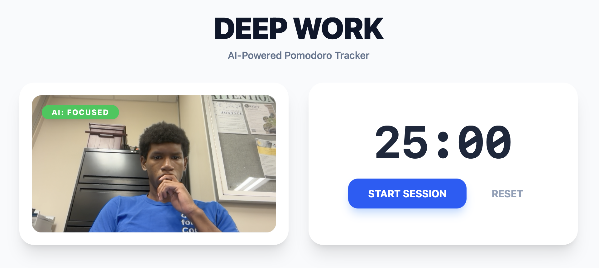
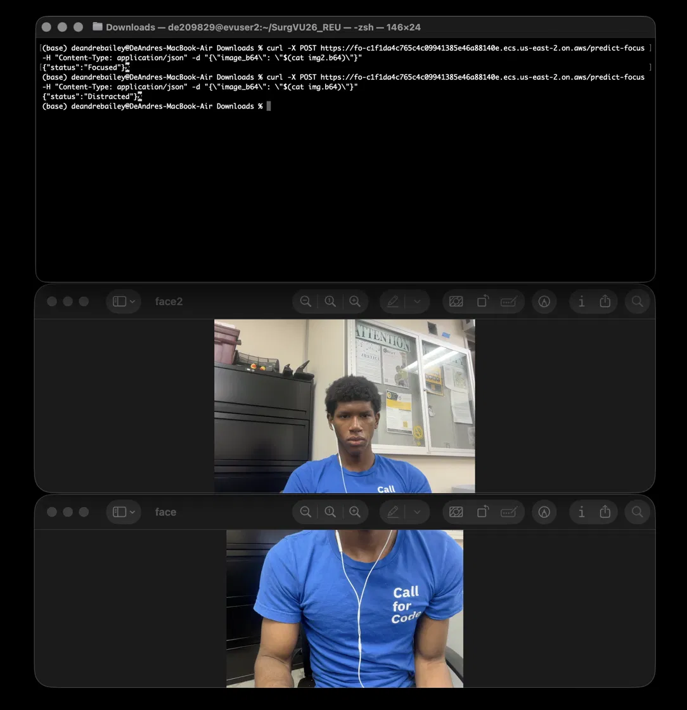

# Deep Work: Focus-Aware Pomodoro Timer

[](https://github.com/deandrebailey-origin/Focus-Model/actions/workflows/ci.yml)

A full-stack Pomodoro timer that uses a **custom PyTorch CNN** to tell whether you're focused. Your webcam is sampled about every 500 ms. When the model detects that you're distracted or have looked away, the timer **pauses** and the UI changes color, so only real focus time counts.

The model is served by a **FastAPI** inference API, containerized with **Docker**, and **automatically deployed to AWS ECS (Fargate)** by a GitHub Actions CI/CD pipeline.

<p align="center">
  
</p>

---

## How it works

```
Browser (React)  ──every ~500 ms──►  nginx  ──/api/──►  FastAPI  ──►  PyTorch CNN
  webcam frame (base64)              reverse proxy       validate + decode     Focused / Distracted
        ◄──────────────────────────── {"status": "Focused"} ◄──────────────────────┘
```

1. The **React** frontend captures a webcam frame and sends it as base64 JSON to `/api/predict-focus`.
2. **nginx** serves the frontend and proxies `/api/` to the API over a private Docker network, so the API is never exposed directly.
3. **FastAPI** validates the input, decodes the image **in memory** (frames are never stored), and runs the CNN.
4. The response updates the UI and pauses or resumes the timer.

## Tech stack

| Layer | Tools |
|---|---|
| Model | PyTorch (custom CNN), torchvision |
| API | FastAPI, Uvicorn, Pillow |
| Frontend | React, TypeScript, Vite, Tailwind CSS |
| Serving | nginx (reverse proxy), Docker multi-stage builds, Docker Compose |
| CI/CD | GitHub Actions: ruff, pytest, ESLint, image builds, automated deploy |
| Cloud | AWS ECR, ECS (Fargate), Application Load Balancer, IAM, CloudWatch |

---

## Run it locally

**Prerequisite:** Docker Desktop.

```bash
docker compose up --build
```

Open **http://localhost:8080** and allow camera access.

### Development mode (without Docker)

```bash
# API
cd api
python -m venv .venv && source .venv/bin/activate
pip install torch torchvision --index-url https://download.pytorch.org/whl/cpu
pip install -r requirements-dev.txt
uvicorn main:app --reload --port 8000

# Frontend (new terminal)
cd app
npm ci
npm run dev
```

The Vite dev server proxies `/api` to `localhost:8000`, so the frontend code is the same in dev and production.

## API

| Method | Endpoint | Description |
|---|---|---|
| `GET` | `/health` | Liveness check, returns `{"status": "ok"}` |
| `POST` | `/predict-focus` | Body: `{"image_b64": "<base64 image>"}` and returns `{"status": "Focused" \| "Distracted"}` |

**Input validation:** invalid base64 or a non-image returns **400**, and payloads over ~2 MB return **413**.

```bash
base64 -i face.jpg | tr -d '\n' > img.b64
curl -X POST http://localhost:8080/api/predict-focus \
  -H "Content-Type: application/json" \
  -d "{\"image_b64\": \"$(cat img.b64)\"}"
```

## Tests

```bash
cd api && ruff check . && python -m pytest -v
cd app && npm run lint && npm run build
```

---

## CI/CD and deployment

```
Pull request ──► CI: lint + tests (API & frontend) + Docker image builds
Merge to main ──► CI ──► build image ──► push to Amazon ECR (tagged with commit SHA)
                       ──► deploy to ECS Fargate behind an ALB ──► smoke test GET /health
```

- **CI runs on every pull request.** Branch protection requires it to pass before merging.
- **CD runs only after merge to `main`.** PRs never deploy, so production always matches `main`.
- **Images are tagged with the git commit SHA**, so every deployment traces back to its exact code, and rolling back means redeploying an earlier SHA.
- **A post-deploy smoke test** fails the pipeline if the new version doesn't respond.

<p align="center">
  
</p>

### Infrastructure notes

- **Least-privilege deploy credentials:** the pipeline uses an IAM user that can only push to this one ECR repository, update this one ECS service, and pass the two ECS roles it needs. *(OIDC federation is the better practice and wasn't available on the AWS account's free plan.)*
- **Architecture:** images are built for `linux/amd64` to match Fargate's x86 hosts. GitHub's runners are x86 natively; local builds on Apple Silicon need `--platform linux/amd64`.
- **Health checks:** the ALB routes traffic only to containers passing `GET /health`.

## Engineering details

- **Multi-stage Docker builds:** the frontend image is ~76 MB (nginx plus static files, no Node.js). The API image runs as a **non-root user** with a Docker `HEALTHCHECK` and CPU-only PyTorch.
- **Private networking:** in Compose, only nginx publishes a port. The API is reachable only from inside the Docker network.
- **Config via environment variables:** `MODEL_PATH`, `ALLOWED_ORIGINS` (CORS) and `VITE_API_URL`, so the same code runs locally and in the cloud.
- **Privacy:** frames are processed in memory and never written to disk or logged.

## Project structure

```
api/
  main.py            FastAPI app: /health, /predict-focus, validation
  model.py           CNN definition, preprocessing, load_model, predict
  focus_model.pth    trained weights
  tests/             pytest suite
  Dockerfile
app/
  src/               React + TypeScript frontend
  nginx.conf         static files + /api reverse proxy
  Dockerfile         multi-stage: Node build → nginx
docker-compose.yml
.github/workflows/ci.yml   CI + CD pipeline
```

## Roadmap

- [ ] Session logging in PostgreSQL with focus analytics (streaks, focus by time of day)
- [ ] Labeled evaluation set with an accuracy gate in CI
- [ ] Frontend hosted on Vercel for a public demo
- [ ] C++ (ONNX Runtime) inference and latency benchmarks